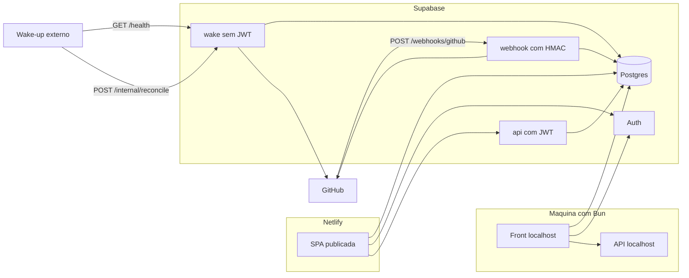

# Planejamento — Centralizador de repositórios GitHub

Documento de construção. O diretório da aplicação ainda está vazio. Este arquivo é a especificação que a implementação deve seguir.

O wake-up em [wakeuprender](https://wakeuprender.netlify.app/) é um projeto apartado. Este repositório não implementa cron, ping nem keep-alive. Ele publica os endpoints que aquele serviço chama.

## 1. Para que serve

Uma pessoa que mexe em muitos repositórios precisa de um lugar só para acompanhar o que foi feito e para mostrar isso a outras pessoas sem abrir o GitHub.

O centralizador:

- conecta contas GitHub públicas e privadas por personal access token;
- grava metadados dos commits num banco;
- acompanha sozinho, por webhook de push e por verificação periódica;
- classifica cada projeto por linguagem, tipo de código, tipo de projeto e quantidade de funcionalidades;
- mostra um painel com senha para quem opera;
- mostra uma vitrine, também com senha, sem URL de repositório, sem caminho de arquivo e sem chave.

O código-fonte dos repositórios não entra no banco. O que se guarda do trabalho é a história: quem, quando, a mensagem, o volume da mudança e, no painel, os nomes dos arquivos alterados.

## 2. Onde cada parte mora

O Netlify gratuito publica site estático e funções de cerca de 10 segundos. Não tem banco e não aguenta percorrer vários repositórios. O front fica no Netlify. O resto fica no Supabase, no plano gratuito:

- Postgres para os dados;
- Auth com e-mail e senha;
- Edge Functions em TypeScript para os endpoints.

Não há servidor permanente, FastAPI nem Render. A Edge Function sobe quando alguém chama. O teto de uma chamada fica na ordem de 150 segundos. Por isso a sincronização anda em fatias: uma chamada processa um pedaço, grava o cursor e, se ainda faltar trabalho, responde `pending: true`. O wake-up externo chama de novo a cada 14 minutos.

Limites que a implementação tem de respeitar:

- banco gratuito do Supabase na casa de 500 MB, daí a recusa de diff e de blob;
- API autenticada do GitHub na casa de 5000 pedidos por hora;
- uma fatia tem de terminar dentro do teto da Edge Function.

## 3. Desenvolvimento local com Bun

O dia a dia roda na máquina. Publicar no Netlify e no Supabase vem depois que o fluxo local funciona.

Bun é o runtime e o gerenciador de pacotes. O handler compartilhado usa só APIs web: `Request`, `Response`, `fetch`, `crypto.subtle`. A Edge Function executa em Deno, então esse handler não importa `bun:` nem `node:`. O adaptador `Bun.serve` fica num arquivo que não é publicado.

O banco do desenvolvimento é o projeto Supabase gratuito. Front e API na máquina apontam para ele por `.env`, que não entra no git. Não há Docker nem Postgres local nesta entrega.

### Layout

```text
apps/web/                         Vite, React, TypeScript
supabase/functions/_shared/       rotas e regras de sincronização
supabase/functions/api/index.ts
supabase/functions/wake/index.ts
supabase/functions/github-webhook/index.ts
src/dev.ts                        Bun.serve local, despacha as três funções
supabase/migrations/              SQL
supabase/config.toml              verify_jwt por função
documentacao/planejamento.md
.env                              não versionado
.env.example                      nomes, sem valores
```

### Comandos

Na raiz:

```bash
bun install
bun run dev
```

`bun run dev` sobe o front e a API juntos. O front local chama a API local. O front publicado chama a URL da Edge Function. A variável de ambiente troca o destino. As rotas e as checagens são as mesmas. O servidor local recusa a rota protegida se o JWT não valida. Não existe modo sem autenticação no desenvolvimento.

### Variáveis

No servidor local e nos segredos da Edge Function:

- `SUPABASE_URL`
- `SUPABASE_ANON_KEY`
- `SUPABASE_SERVICE_ROLE_KEY`

No front, só o que pode ser público:

- `VITE_SUPABASE_URL`
- `VITE_SUPABASE_ANON_KEY`
- `VITE_API_URL`

A service role não entra no front, no painel de ambiente do Netlify nem no repositório do wake-up. Token de GitHub não entra em variável nenhuma: ele nasce no formulário, vai para o Vault e não volta.

## 4. Arquitetura



O gateway do Supabase liga ou desliga o JWT na função inteira, não em cada rota. Por isso são três funções.

| Função | Gateway | Quem chama | O que prova a identidade |
| --- | --- | --- | --- |
| `api` | `verify_jwt = true` | front do operador e do visitante | JWT do Supabase, papel conferido de novo no código |
| `wake` | `verify_jwt = false` | wake-up externo | nada; contrato simples e resposta sem dados |
| `github-webhook` | `verify_jwt = false` | GitHub | `X-Hub-Signature-256` por repositório |

O GitHub não envia o nosso JWT. A função do webhook não é a exceção simples do wake-up: sem assinatura válida a chamada termina em `401` e corpo vazio, e nada é gravado.

O painel lê views do schema `public` com a sessão do usuário. O navegador manda a anon key mais o JWT. Mutações que precisam da chave do GitHub passam pela função `api`, que cria um cliente Postgres com o JWT do usuário para a policy valer, e usa a service role só no trecho que cifra, decifra e grava o resultado da sincronização.

## 5. Papéis

O cadastro público do Supabase fica desligado. As contas nascem no setup, criadas por quem opera.

- `operator` — uma conta. Painel, conexões, repositórios, commits, arquivos, classificação, notas, erros de sync. Não lê a chave: a coluna não existe nas views.
- `viewer` — uma ou mais contas criadas pelo operador para visitas. Só as views da vitrine. Sem insert, update ou delete.

O papel mora em `private.profiles.app_role` e é a fonte da policy. O front lê `public.my_profile` para saber qual tela abrir. Um JWT sem linha em `profiles` não vê nada.

Senha forte na conta operadora. A sessão do front é a do cliente oficial do Supabase, no header `Authorization`. A função `api` confere de novo `exp`, `aud` e `sub`, e o papel, mesmo com o gateway já tendo validado a assinatura.

## 6. Criptografia

Três camadas. Cifrar só o disco deixa a chave legível para quem consegue um `select`. Cifrar só na aplicação e guardar a chave ao lado da service role também é fraco se os dois vazam juntos. O desenho separa as camadas e tira a chave do alcance do navegador.

### Em trânsito

TLS no Supabase, no Netlify e no GitHub. Quando o front publicado chama a função, a chamada é HTTPS.

### Em repouso, no disco

O volume do Postgres no Supabase é cifrado pelo provedor. Isso protege o disco físico. Não impede a leitura de uma coluna em claro por SQL.

### No conteúdo das chaves

Tokens GitHub e segredos de webhook ficam no Supabase Vault, cifrados com pgsodium. A extensão é a `supabase_vault`. O segredo é criado por `vault.create_secret`. O id devolvido fica em `private.github_connections.vault_secret_id` ou em `private.repositories.webhook_vault_secret_id`.

A tabela de conexão não tem coluna de token. As views públicas não juntam `vault.decrypted_secrets`. O schema `vault` não entra nos schemas expostos pelo Data API.

A única leitura do valor decifrado é a função `private.use_github_token(connection_id uuid)`, `security definer`, com `revoke all` de `public`, `anon` e `authenticated`, e `grant execute` só para `service_role`. Ela:

1. confirma que o chamador é `service_role`;
2. lê o segredo daquela conexão;
3. grava uma linha em `private.secret_uses` com a conexão, a ação e o horário, sem o segredo;
4. devolve o token para a função, que o usa na memória no header `Authorization` do pedido ao GitHub e descarta.

O token decifrado não vai para `console.log`, resposta HTTP, `sync_runs.error` nem para o texto de exceção persistido. Se o GitHub recusar o token, o erro gravado é a situação HTTP e a mensagem genérica, com o header de autorização removido.

A rotação cria um segredo novo, aponta a conexão para o id novo e apaga o segredo antigo no Vault. O token anterior deixa de existir no banco.

Permissões pedidas ao token fino do GitHub:

- leitura de conteúdo, para commits e linguagens;
- leitura de metadados;
- administração do repositório só se a função for criar o webhook sozinha.

Sem administração, o repositório entra em `sync_mode = reconcile_only` e segue acompanhado pela função `wake`.

## 7. RLS

RLS ligado e `force row level security` em toda tabela dos schemas `private` e `public`. Sem policy, o papel não vê a linha. O papel `anon` não tem policy nenhuma.

`revoke all` de `anon` e `authenticated` nas tabelas-base. As tabelas-base ficam em `private`, e `private` não está na lista de schemas expostos pelo Data API. O navegador só enxerga views em `public`.

Cada view é criada com `security_invoker = on`. A policy de quem chama vale por baixo da view. Uma view não vira um atalho para furar o RLS.

Funções estáveis, `security definer`, leem o papel a partir de `auth.uid()`:

```sql
private.is_operator()  -- existe profiles com app_role = 'operator' para auth.uid()
private.is_viewer()    -- existe profiles com app_role = 'viewer' para auth.uid()
```

`search_path` fixo nelas, para não herdar schema de quem chama.

### Policies do operador

`for all` em conexões, repositórios, commits, arquivos, linguagens, funcionalidades, sync e o próprio perfil. `using` e `with check` chamam `private.is_operator()`.

O operador continua sem `select` em `vault.secrets`, `vault.decrypted_secrets` e sem `execute` em `private.use_github_token`.

### Policies do visitante

`for select` apenas, e só em repositório com `visibility = 'vitrine'`, mais as linhas-filhas desse repositório em linguagens, funcionalidades marcadas para a vitrine, e commits que tenham `showcase_message` preenchida.

Sem policy de insert, update ou delete. Sem policy nenhuma, para o visitante, em:

- `commit_files`
- `sync_runs`
- `github_connections`
- `secret_uses`
- notas internas e texto de erro

### Segredos

Nenhuma policy para `authenticated` nem para `anon` no Vault e em `private.secret_uses`. A service role ignora RLS. Por isso ela não sai da Edge Function. A função de painel fala com o Postgres com o JWT do usuário. A service role fica no trecho de cifra, decifra e gravação da sincronização.

### Views

`public.my_profile` — a linha do `auth.uid()`.

Para o operador:

- `public.panel_connections` — id, rótulo, login, pausa. Sem `vault_secret_id`.
- `public.panel_repositories` — identidade GitHub, URLs, visibilidade, classificação, cursor, status, erro.
- `public.panel_commits` — mensagem original, autor, data, adições, remoções, arquivos contados.
- `public.panel_commit_files` — caminho, status, adições, remoções.
- `public.panel_languages`
- `public.panel_features`
- `public.panel_sync_runs`

Para o visitante:

- `public.showcase_repositories` — id interno, título de vitrine, resumo, tipo de projeto, tipo de código, destaque marcado como público, quantidade de funcionalidades. Sem `owner`, `name`, `full_name`, `html_url`, `clone_url`, `homepage`, cursor, erro, id do GitHub.
- `public.showcase_commits` — data, `showcase_message`, adições, remoções, quantidade de arquivos. Sem SHA, sem autor de login, sem mensagem original, sem URL.
- `public.showcase_languages` — nome da linguagem e percentual.
- `public.showcase_features` — nome e descrição das funcionalidades com `show_in_showcase`.

A mensagem original do commit fica no painel. Ela só aparece na vitrine se o operador escrever `showcase_message`. Mensagem vazia significa que aquele commit não entra na view do visitante. Mensagem de commit costuma carregar caminho, ticket e nome interno.

### Teste que fecha a entrega

Três chamadas ao Data API e uma à função `wake`:

1. sem JWT — nenhuma view devolve linha;
2. JWT de viewer — vitrine sem URL, sem caminho, sem chave, sem mensagem original, sem erro de sync;
3. JWT de operator — painel completo, e a resposta ainda sem o token;
4. `GET /health`, `POST /internal/reconcile` e `GET /internal/status` — corpo só com os campos combinados, sem nome de repositório.

Uma busca no corpo das quatro respostas não encontra o prefixo `github_pat_`, `ghp_` nem o segredo de webhook.

## 8. Modelo de dados

Tipos abaixo são o contrato das migrations. Nomes podem ganhar prefixo de schema; as colunas não encolhem sem atualizar este documento.

### `private.profiles`

- `user_id uuid` chave primária, referência a `auth.users`
- `app_role text` com checagem `operator` ou `viewer`
- `created_at timestamptz`

### `private.github_connections`

- `id uuid` chave primária
- `label text` não nulo
- `github_login text` não nulo
- `vault_secret_id uuid` não nulo
- `paused boolean` padrão falso
- `created_at timestamptz`
- `updated_at timestamptz`

### `private.repositories`

- `id uuid` chave primária
- `connection_id uuid` não nulo, referência à conexão
- `github_repo_id bigint` não nulo, único
- `owner text`, `name text`, `full_name text` não nulos
- `is_private boolean` não nulo
- `default_branch text` não nulo
- `description text`
- `homepage text`
- `html_url text`
- `clone_url text`
- `visibility text` com checagem `interno` ou `vitrine`, padrão `interno`
- `showcase_title text`
- `showcase_summary text`
- `highlight text` — o que o projeto prova, se o operador quiser mostrar
- `highlight_public boolean` padrão falso
- `internal_note text`
- `project_type text` com a lista da seção 10
- `code_kind text` com a lista da seção 10
- `topics text[]` — sugestão vinda do GitHub, não vira tipo sozinha
- `sync_mode text` com checagem `webhook` ou `reconcile_only`
- `webhook_vault_secret_id uuid`
- `github_hook_id bigint`
- `last_synced_sha text`
- `history_limit int` padrão 100
- `history_since timestamptz` padrão de 90 dias atrás, gravado no cadastro
- `backfill_page int` padrão 1
- `backfill_done boolean` padrão falso
- `sync_status text` com checagem `idle`, `running`, `error`, `paused`
- `sync_error text`
- `paused boolean` padrão falso
- `created_at timestamptz`
- `updated_at timestamptz`

### `private.repository_languages`

- `repository_id uuid`
- `language text`
- `bytes bigint` não nulo
- chave primária `(repository_id, language)`

O percentual é calculado na view, a partir da soma de `bytes` do repositório.

### `private.features`

- `id uuid` chave primária
- `repository_id uuid` não nulo
- `name text` não nulo
- `description text`
- `show_in_showcase boolean` padrão verdadeiro
- `position int` não nulo
- `created_at timestamptz`

A quantidade de funcionalidades da ficha e da vitrine é `count(*)` das linhas daquele repositório. Na vitrine, a contagem usa só `show_in_showcase`.

### `private.commits`

- `id uuid` chave primária
- `repository_id uuid` não nulo
- `sha text` não nulo
- único `(repository_id, sha)`
- `message text` não nulo
- `showcase_message text`
- `author_name text`
- `author_login text`
- `committed_at timestamptz` não nulo
- `additions int`
- `deletions int`
- `files_changed int`
- `files_truncated boolean` padrão falso

### `private.commit_files`

- `id uuid` chave primária
- `commit_id uuid` não nulo
- `filename text` não nulo
- `status text` com checagem `added`, `modified`, `removed`, `renamed`
- `additions int`
- `deletions int`

No máximo 100 arquivos por commit. Acima disso, grava os 100 primeiros e marca `files_truncated`.

### `private.sync_runs`

- `id uuid` chave primária
- `trigger text` com checagem `webhook`, `reconcile`, `manual`
- `repository_id uuid`
- `status text` com checagem `running`, `ok`, `error`
- `pending boolean`
- `repos_remaining int`
- `commits_added int`
- `error text`
- `started_at timestamptz`
- `finished_at timestamptz`

Índice único parcial em que `status = 'running'`, para existir no máximo uma rodada ao mesmo tempo.

### `private.secret_uses`

- `id uuid` chave primária
- `connection_id uuid` não nulo
- `action text` com checagem `decrypt_for_sync`, `decrypt_for_webhook`, `rotate`
- `occurred_at timestamptz`

Sem coluna de segredo. O operador vê essa auditoria por `public.panel_secret_uses`. O visitante não.

## 9. Endpoints

Corpos em JSON. Erro no formato `{ "error": "..." }` sem ecoar segredo, SQL nem stack.

### Função `wake`

Única chamada simples, sem JWT e sem assinatura. A URL não aparece no front. Quem a conhece consegue pedir uma sincronização. A resposta continua sem dados de repositório.

`GET /health`

```json
{ "status": "ok" }
```

Não consulta o GitHub nem o Vault.

`POST /internal/reconcile`

Sem cabeçalho de autorização. Anda uma fatia, descrita na seção 11. Respostas:

```json
{ "pending": true }
```

```json
{ "pending": false }
```

```json
{ "already_running": true }
```

`GET /internal/status`

```json
{ "pending": false, "error": false, "repos_remaining": 0 }
```

`error` é booleano. Sem id, sem mensagem de erro, sem nome.

Publicada, a base é `https://<ref>.supabase.co/functions/v1/wake`. O outro projeto é quem grava essa URL.

### Função `github-webhook`

`POST /webhooks/github`

Cabeçalhos usados: `X-Hub-Signature-256`, `X-GitHub-Event`, `X-GitHub-Delivery`, `X-GitHub-Hook-ID`.

Passos:

1. Ler o corpo cru, antes de interpretar JSON. A assinatura é do corpo cru.
2. Achar o repositório pelo `github_hook_id` ou, no evento, por `repository.id`.
3. Decifrar o segredo daquele repositório com `private.use_github_token` no caminho de webhook, ação `decrypt_for_webhook`.
4. Calcular HMAC-SHA256 e comparar em tempo constante com o header. Prefixo esperado: `sha256=`.
5. Evento `ping`: `200` e `{ "ok": true }`.
6. Evento `push`: gravar os commits novos que caibam na chamada. O payload já traz a lista de arquivos adicionados, removidos e modificados. Contagem de linhas que não vier no payload fica nula e a reconciliação completa depois.
7. Qualquer outra falha de assinatura: `401` e corpo vazio. Não grava `sync_run` com o corpo do pedido.

### Função `api`

Todas exigem `Authorization: Bearer <jwt>`. Papel `operator`, exceto onde estiver escrito o contrário. O visitante não chama mutação.

`GET /me` — operator e viewer. Devolve `{ "role": "operator" | "viewer" }`.

`POST /connections` — corpo `{ "label": "...", "token": "..." }`. A função chama o GitHub `GET /user` com o token, grava o segredo no Vault, grava a conexão sem o token e responde `{ "id", "label", "github_login" }`. O token não volta.

`DELETE /connections/:id` — remove a conexão, os repositórios dependentes em cascata e o segredo no Vault.

`POST /repositories` — corpo `{ "connection_id": "...", "full_name": "owner/name" }`. Lê o repositório no GitHub, grava a linha, tenta criar o webhook e dispara a primeira fatia de carga. Se o hook falhar por permissão, grava `sync_mode = reconcile_only` e segue.

`PATCH /repositories/:id` — campos editáveis: `paused`, `visibility`, `showcase_title`, `showcase_summary`, `highlight`, `highlight_public`, `internal_note`, `project_type`, `code_kind`, `history_limit`.

`POST /repositories/:id/sync` — pede uma fatia manual daquele repositório. Mesmo formato de resposta da reconciliação, com `trigger = manual`.

`POST /features` — `{ "repository_id", "name", "description", "show_in_showcase", "position" }`.

`PATCH /features/:id` e `DELETE /features/:id`.

`PATCH /commits/:id` — só aceita `showcase_message`.

Listagens do painel e da vitrine saem das views pelo Data API, com o JWT, não por estas rotas. Assim a policy continua sendo a barreira, e a função não reimplementa o filtro no aplicativo.

CORS da função `api` limitado à origem do Netlify e a `http://localhost` na porta do Vite. A função `wake` não precisa de CORS de navegador.

## 10. Classificação

Quatro eixos, de propósito separados.

**Linguagem.** Automática. `GET /repos/{full_name}/languages` devolve bytes por linguagem. A reconciliação atualiza `repository_languages`. O percentual é bytes da linguagem dividido pela soma do repositório.

**Tipo de código.** Escolha do operador, um valor:

- `aplicacao`
- `biblioteca`
- `script`
- `infraestrutura`
- `dados`
- `documentacao`
- `misto`

**Tipo de projeto.** Escolha do operador, um valor:

- `produto`
- `experimento`
- `biblioteca`
- `site`
- `ferramenta`
- `pesquisa`
- `automacao`
- `estudo`

`topics` do GitHub aparecem na ficha como sugestão. Não preenchem `project_type` sozinhos.

**Funcionalidades.** Cadastro manual: nome e descrição curta. A quantidade é a contagem das linhas. Não se infere funcionalidade lendo código. Inferir puxaria fonte para o banco e erraria em silêncio.

Conhecimento no projeto:

- `showcase_summary` — pode ir para a vitrine;
- `internal_note` — só o painel;
- `highlight` — a vitrine só se `highlight_public` for verdadeiro.

Filtros do painel: linguagem, tipo de código, tipo de projeto, visibilidade, pausa. Filtros da vitrine: linguagem, tipo de código, tipo de projeto. Os filtros da vitrine consultam só as views `showcase_*`.

## 11. Acompanhamento

Dois caminhos chegam na mesma gravação de commits.

### Carga inicial

No cadastro, `history_limit` vale 100 e `history_since` vale 90 dias antes, o que vier primeiro ao cortar a lista. A primeira fatia começa na hora. As seguintes dependem do wake-up, ou de `POST /repositories/:id/sync`.

### Fatia da reconciliação

1. Se existir `sync_runs.status = 'running'` com `started_at` nos últimos 2 minutos, responder `already_running` e não empilhar.
2. Se a rodada `running` for mais velha que 2 minutos, marcá-la `error` com texto `fatia interrompida` e seguir. Isso solta o cadeado quando a função morre no teto de tempo.
3. Abrir uma `sync_run` com `trigger` igual a `reconcile` ou `manual`.
4. Escolher um repositório com `paused = false` e (`backfill_done = false` ou defasagem a verificar), o mais antigo em `updated_at`.
5. Na fatia manual, o repositório é o da URL, se não estiver pausado.
6. Decifrar o token da conexão.
7. Pedir uma página de até 20 commits, `page = backfill_page`, `since = history_since`.
8. Parar a página no `history_limit` já gravado para aquele repositório.
9. Para cada SHA novo, gravar o commit. Se o payload não tiver linhas adicionadas e removidas, um pedido ao commit individual completa os números, dentro do que couber no tempo. Se o tempo apertar, gravar o que já veio e deixar `backfill_page` onde parou.
10. Gravar no máximo 100 arquivos e marcar truncamento.
11. De tempos em tempos na mesma fatia, se ainda houver folga, atualizar as linguagens.
12. Avançar `backfill_page`. Se a página voltar vazia ou o limite for atingido, `backfill_done = true` e `last_synced_sha` no SHA mais recente.
13. Fechar a `sync_run`. `pending` é verdadeiro se ainda existir repositório não pausado com carga incompleta ou com SHA local diferente do SHA remoto. A comparação do SHA remoto pode ficar para a fatia seguinte, para esta chamada não percorrer a lista inteira.
14. `repos_remaining` é a contagem desses repositórios depois da fatia.

A função `wake` traduz isso para `{ "pending": true | false }` ou `{ "already_running": true }`.

### Webhook

Um push grava os commits daquele evento e atualiza `last_synced_sha` com o `after` do payload. Não refaz a carga inteira. Se o webhook não existir, o modo `reconcile_only` cobre o buraco na fatia seguinte: a função compara o SHA remoto e pede o que falta.

### O que não se baixa

Diff, blob, árvore completa, README bruto como fonte, issues, pull requests e releases. Fora desta entrega, listados de novo na seção 14.

## 12. Telas

O front é uma SPA em português, Vite e React, com a sessão do Supabase.

1. **Entrar.** E-mail e senha. Sem link de cadastro.
2. **Painel.** Linha do tempo de todos os repositórios, do mais recente ao mais antigo, com filtros da seção 10. Cada item abre a ficha.
3. **Conexões.** Lista rótulo e login. Formulário de token. O campo da chave é senha, não fica no estado depois do envio, e a resposta não a devolve.
4. **Ficha.** Classificação, notas, destaque, visibilidade, pausa, linguagens, funcionalidades com a contagem, commits e arquivos, status da última sync, botão de sincronizar agora.
5. **Vitrine.** Para o JWT `viewer`. Cartões com título, resumo, tipos, linguagens, quantidade de funcionalidades e destaque público. A ficha da vitrine mostra a linha do tempo sanitizada. Não há campo de URL nem botão de copiar remoto.

Quem entra com papel `viewer` não vê menu de conexões, sync nem notas internas. A barreira de verdade é a view; esconder o menu só evita o pedido inútil.

Cabeçalhos do site publicado: HSTS e uma Content-Security-Policy que permite o próprio Netlify, o domínio do Supabase do projeto e recusa o resto.

## 13. Ordem de construção

Tudo na máquina, com Bun, antes de publicar.

1. Projeto Bun, migrations dos schemas `private` e `public`, Vault, RLS forçado, views e as duas contas. A função `wake` local responde as três rotas ainda sem GitHub. A função `api` local já recusa chamada sem JWT.
2. Front local: login e casca do painel lendo `panel_*` com o JWT do operador.
3. Conexão por token no Vault, cadastro de repositório e carga inicial em fatias.
4. Webhook com HMAC e reconciliação de verdade, com cursor e `sync_runs`.
5. Classificação, funcionalidades e filtros.
6. Views da vitrine e o teste dos três acessos mais a resposta da `wake`.
7. Publicar o front no Netlify e as três funções no Supabase. O wake-up externo, no outro projeto, aponta só para a função `wake`.

## 14. Fora desta entrega

- Código do wake-up, o cron e a lista de URLs daquele projeto.
- Render, FastAPI e qualquer processo permanente para acordar.
- Guardar fonte, diff ou busca dentro de arquivo.
- GitHub App ou OAuth no lugar do personal access token.
- Issues, pull requests e releases.
- Resumo automático por modelo de linguagem.
- Vários operadores. Visitantes adicionais, sim, cada um com o papel `viewer`.
- Postgres local ou Docker.
- Vitrine anônima. O visitante usa JWT. A única chamada sem JWT e sem assinatura é a função `wake`.

## 15. Critério de pronto

A entrega está pronta quando, na máquina:

- um operador entra com e-mail e senha, grava um token e o token não aparece em view, log nem resposta;
- um repositório privado sincroniza uma fatia e mostra commits e arquivos no painel;
- `POST /internal/reconcile` sem JWT anda a fatia seguinte e devolve só `pending` ou `already_running`;
- um push assinado grava o commit, e um push sem assinatura não grava;
- um visitante vê a vitrine sem remoto, sem caminho e sem a mensagem original;
- o teste da seção 7 passa.
